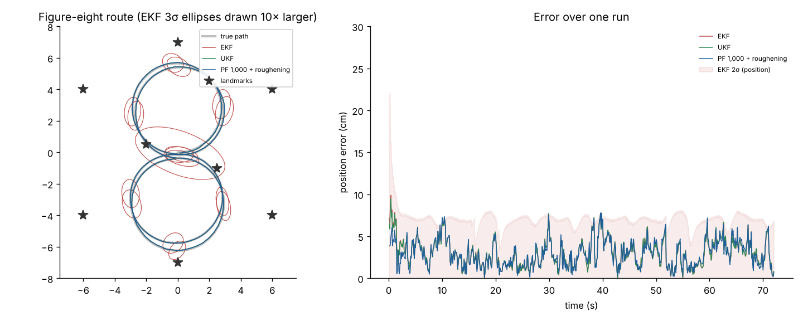
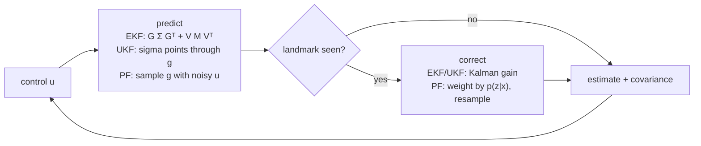
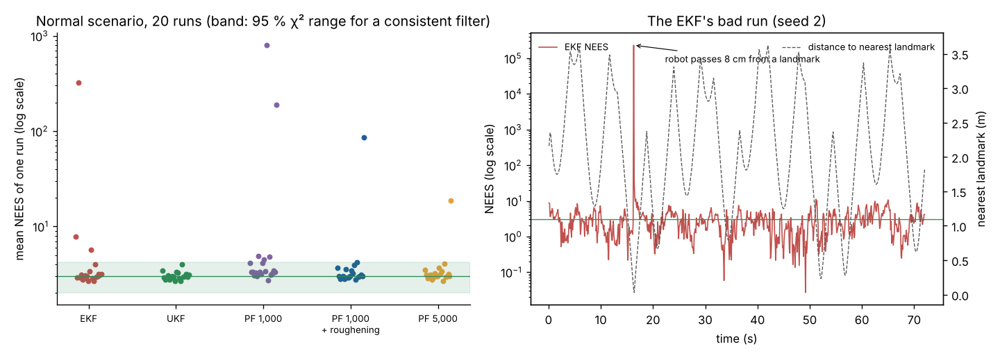
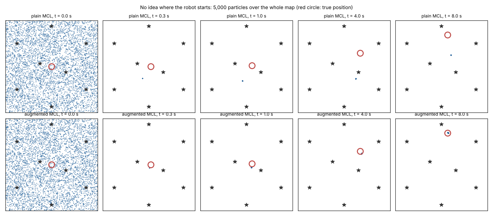

# robot-localization

A robot drives a figure of eight among landmarks, measuring their range and bearing. Three
classic Bayes filters estimate where it is: an extended Kalman filter, an unscented Kalman
filter, and a particle filter (Monte Carlo localisation). They are scored on two things:

- **accuracy:** how far the estimate is from the truth;
- **consistency:** whether each filter's own uncertainty is honest, judged with the normalised
  estimation error squared (NEES) over 20 Monte Carlo runs.

All three filters turn out to be equally *accurate*. What separates them is whether you can
*trust their error bars*, and each one fails that test in its own characteristic way.



## The models

State (x, y, θ), control (v, ω), from Thrun, Burgard & Fox's *Probabilistic Robotics*:

- **Motion (velocity model).** The robot follows an arc of radius v/ω:
  x′ = x − (v/ω) sin θ + (v/ω) sin(θ + ωΔt), and similarly for y. It moves in a straight line as
  ω → 0. The executed controls are noisy.
- **Measurement.** For a landmark m: r = ‖m − p‖, φ = atan2(m_y − y, m_x − x) − θ. Noise:
  15 cm in range and 0.03 rad in bearing. The sensor sees landmarks within 6 m; IDs are known.

| filter | how it represents belief | key step |
|---|---|---|
| EKF | one Gaussian | linearise motion and measurement with Jacobians G, V, H |
| UKF | one Gaussian | push 7 sigma points through the true nonlinear functions |
| particle filter | 1,000 or 5,000 weighted samples | sample the motion model, weight by likelihood, systematic resampling |



## How consistency is measured

If a filter's covariance Σ is honest, then NEES = eᵀ Σ⁻¹ e, with e the true error, follows a
χ² distribution with 3 degrees of freedom. Its mean is 3. Averaged over 20 independent runs,
95 % of time steps should fall in the band [2.02, 4.16] (Bar-Shalom, Li & Kirubarajan). A mean
NEES far above 3 means the filter is *overconfident*: it believes it knows where it is when it
doesn't. That is the dangerous failure, because whatever consumes the estimate trusts it.

## Results (20 runs per scenario)

| scenario | filter | position RMSE | heading RMSE | mean NEES | median run | worst run | time per step |
|---|---|---:|---:|---:|---:|---:|---:|
| **normal** | EKF | 3.6 cm | 0.61° | 19.5 | 3.04 | 325 | 0.12 ms |
| | UKF | 3.6 cm | 0.61° | **3.03** | 2.95 | 4.0 | 0.20 ms |
| | PF, 1,000 | 4.0 cm | 0.62° | 52.5 | 3.34 | 798 | 0.49 ms |
| | PF, 1,000 + roughening | 4.0 cm | 0.64° | 7.3 | 3.03 | 86.5 | 0.56 ms |
| | PF, 5,000 | 3.6 cm | 0.62° | 3.92 | 3.07 | 18.7 | 1.63 ms |
| **0.3 m sensor dead zone** | EKF | 3.5 cm | 0.61° | **2.95** | 2.84 | 4.0 | 0.12 ms |
| | UKF | 3.5 cm | 0.61° | 2.94 | 2.83 | 4.0 | 0.20 ms |
| | PF, 1,000 | 3.7 cm | 0.62° | 3.60 | 3.19 | 7.4 | 0.51 ms |
| | PF, 1,000 + roughening | 3.6 cm | 0.63° | 3.07 | 2.96 | 4.1 | 0.53 ms |
| | PF, 5,000 | 3.5 cm | 0.61° | 3.00 | 2.89 | 4.2 | 1.66 ms |
| **hard** (noisier, sparser, wide prior) | EKF | 11.9 cm | 3.13° | 3.11 | 3.09 | 4.1 | 0.06 ms |
| | UKF | 11.8 cm | 3.11° | 3.02 | 2.97 | 3.9 | 0.12 ms |
| | PF, 1,000 | 11.9 cm | 3.09° | 402 | 3.46 | 7,312 | 0.38 ms |
| | PF, 1,000 + roughening | 12.0 cm | 3.11° | **3.14** | 3.09 | 4.4 | 0.42 ms |
| | PF, 5,000 | 11.8 cm | 3.07° | 3.15 | 3.10 | 4.9 | 1.24 ms |

The "hard" scenario uses bearing noise 0.1 rad, a 4 m sensor range, readings every 0.5 s, and a
starting uncertainty of 1 m and 30°. Times are pure NumPy on a 2-vCPU cloud VM.



What the table shows:

1. **Accuracy is a tie.** In every scenario all five filters are within a few millimetres of
   each other.
2. **The EKF fails at close range.** In one run of the normal scenario (seed 2, right panel above)
   the robot passes 8 cm from a landmark. There the bearing changes by radians per centimetre, the
   linearisation is meaningless, and the EKF's NEES jumps to 2 × 10⁵ in a single update. A χ²
   innovation gate (implemented; it does reject gross outliers) does *not* catch it, because the
   innovation looks plausible and it is the Jacobian that's wrong. Ignoring readings closer than
   0.3 m, which real range sensors do anyway, makes the EKF fully consistent.
3. **The UKF is the only filter consistent in every scenario as configured.** Its sigma points
   feel the curvature that the EKF's Jacobian misses.
4. **The 1,000-particle filter suffers sample impoverishment.** When the first readings are much
   sharper than the prior, almost all the weight lands on a few particles. Resampling copies them,
   and the filter reports a tiny covariance around a slightly wrong pose. Roughening (jittering
   particles after resampling, Gordon et al. 1993) or five times more particles makes it consistent
   in the hard scenario. In the normal one they help a lot (worst run 798 → 86.5 and 18.7) but don't
   fully cure it.

## Starting with no idea where the robot is

Global localisation: the particles start spread uniformly over the 16 m × 16 m map at all
headings.



Plain MCL usually works, but sometimes no particle starts near the truth. The first update then
collapses the cloud onto a wrong pose, and only motion noise can drift it back (top row: still wrong
after 8 s). **Augmented MCL** (Thrun et al., Table 8.3) tracks short- and long-term averages of the
measurement likelihood. When the short-term average drops, it injects random particles (bottom row).

| 20 runs | median time until the error stays below 0.3 m | worst |
|---|---:|---:|
| plain MCL | 4.5 s | 41 s |
| augmented MCL | 3.3 s | **8 s** |

An honest note: with landmark identities known, even the EKF and UKF, started 5.7 m away facing
backwards (with a declared uncertainty of 5 m and 180°), recovered in all 20 runs. Each identified
landmark pins the pose down quickly. The particle filter's real advantage is with *ambiguous* measurements, such as anonymous
landmarks or symmetric rooms, where the belief is genuinely multimodal. That case isn't simulated
here.

## Tests

18 tests, about 3 s:
- motion and measurement Jacobians against finite differences (including the ω → 0 limit);
- a full circle returning to its start;
- angle wrapping;
- sigma points reproducing mean and covariance;
- systematic resampling copy counts;
- NEES of correctly sized errors landing in the χ² band;
- all three filters localising;
- the EKF close-pass failure and its dead-zone fix;
- roughening preventing particle collapse;
- gate rejection;
- global localisation, and augmented MCL recovering where plain MCL fails.

## Run it

```bash
pip install -r requirements.txt pytest
pytest -q
python scripts/run_experiments.py      # about 3 minutes
pip install matplotlib && python scripts/figures.py
```

## References

- S. Thrun, W. Burgard, D. Fox, *Probabilistic Robotics*, MIT Press (2005): velocity model §5.3,
  EKF localisation Table 7.2, systematic resampling Table 4.4, augmented MCL Table 8.3.
- Y. Bar-Shalom, X. R. Li, T. Kirubarajan, *Estimation with Applications to Tracking and Navigation*, Wiley (2001), §5.4 (NEES).
- E. A. Wan, R. van der Merwe, *The Unscented Kalman Filter for Nonlinear Estimation*, IEEE AS-SPCC (2000).
- N. J. Gordon, D. J. Salmond, A. F. M. Smith, *Novel approach to nonlinear/non-Gaussian Bayesian state estimation*, IEE Proc. F 140 (1993).

## License

MIT
